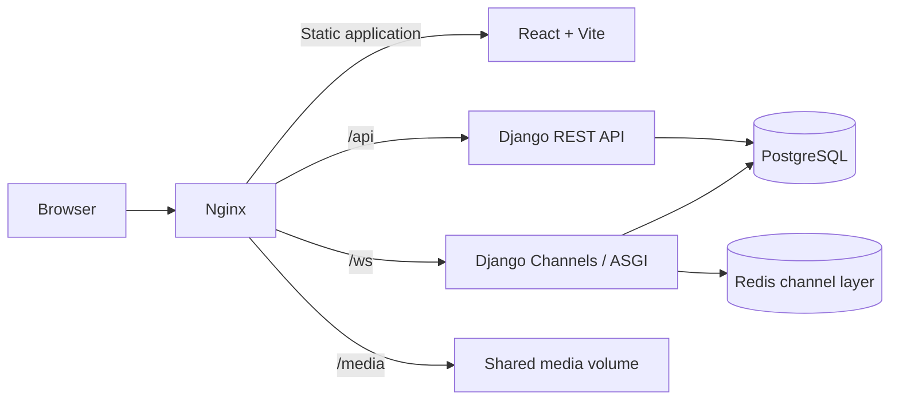

# AMAN Real Estate Platform

AMAN is a full-stack real estate platform for publishing, discovering, and managing residential property offers. It connects property owners and seekers through role-based accounts, structured property search, deal workflows, and real-time messaging.

The application is designed as a production-oriented web system with a React client, a Django REST API, PostgreSQL persistence, Redis-backed WebSocket messaging, Nginx routing, Docker Compose orchestration, and a Jenkins CI/CD pipeline.

## Features

- Role-based accounts for property owners, seekers, and administrators
- JWT authentication, profile management, password updates, and token revocation
- Property creation with document and image uploads
- Property validity tracking and owner-managed renewals
- Search by transaction type, property type, location, rooms, price, and date
- Fair-price averages based on matching active listings
- Saved seeker preferences and property recommendations
- Deal requests, owner approval or rejection, completion, and seeker ratings
- Real-time owner–seeker chat over authenticated WebSockets
- Administrative reports for users and property inventory
- HTTP and WebSocket idempotency protection against duplicate mutations
- Automated backend, frontend, migration, and container checks through Jenkins

## Architecture



Nginx serves the compiled frontend and acts as the single public entry point. API and WebSocket traffic is proxied to the Django ASGI service, while uploaded media is served from a shared Docker volume.

## Technology Stack

| Area | Technologies |
| --- | --- |
| Frontend | React, TypeScript, Vite, React Router |
| Backend | Python, Django, Django REST Framework |
| Authentication | JSON Web Tokens, Simple JWT token blacklist |
| Real-time messaging | Django Channels, WebSockets, Redis |
| Database | PostgreSQL; SQLite for isolated local and CI tests |
| Web server | Nginx |
| Containers | Docker, Docker Compose |
| CI/CD | Jenkins Declarative Pipeline |
| Testing | Django REST Framework integration tests, TypeScript build validation |

## Repository Structure

```text
.
├── backend/                 Django API, Channels, migrations, and tests
│   ├── accounts/            Authentication, profiles, and HTTP idempotency
│   ├── chating/             Conversations and WebSocket messaging
│   ├── deals/               Deal lifecycle and ratings
│   ├── properties/          Listings, search, recommendations, and reports
│   ├── config/              Django and ASGI configuration
│   └── test.py              API integration test suite
├── frontend/                React and TypeScript application
├── jenkins/                 Jenkins pipeline and deployment notes
├── docker-compose.yml       Application service orchestration
├── nginx.conf               Reverse proxy and static/media routing
└── .env.Example             Environment variable template
```

## Prerequisites

- Docker Desktop or Docker Engine with Docker Compose
- Git
- Node.js 18 or later for frontend development
- Python 3.11 or later for backend development
- PostgreSQL and Redis when running services outside Docker

## Quick Start with Docker

1. Clone the repository and enter the project directory.

2. Create a local environment file from the provided template.

   **Windows PowerShell**

   ```powershell
   Copy-Item .env.Example .env
   ```

   **Linux or macOS**

   ```bash
   cp .env.Example .env
   ```

3. Replace the placeholder secret and database password in `.env`.

4. Build and start the application.

   ```bash
   docker compose up --build -d
   ```

5. Create an administrator account when required.

   ```bash
   docker compose exec backend python manage.py createsuperuser
   ```

6. Open `http://localhost`.

The backend container applies database migrations and collects static files before starting the ASGI server.

## Local Development

### Backend

Create and activate a virtual environment, then install the backend dependencies.

```bash
cd backend
python -m venv .venv
```

**Windows PowerShell**

```powershell
.\.venv\Scripts\Activate.ps1
python -m pip install -r requirements.txt
$env:USE_SQLITE = "True"
$env:SECRET_KEY = "local-development-secret-key-with-at-least-32-characters"
python manage.py migrate
python manage.py runserver
```

**Linux or macOS**

```bash
source .venv/bin/activate
python -m pip install -r requirements.txt
export USE_SQLITE=True
export SECRET_KEY=local-development-secret-key-with-at-least-32-characters
python manage.py migrate
python manage.py runserver
```

For real-time messaging across multiple processes, configure `REDIS_URL`. Without it, Django uses an in-memory channel layer intended only for local development and tests.

### Frontend

```bash
cd frontend
npm ci
npm run dev
```

When the Vite development server is used directly, set `VITE_API_BASE_URL` and `VITE_WS_BASE_URL` to the reachable backend addresses, or place the frontend behind the included Nginx configuration.

## Environment Variables

| Variable | Purpose | Example |
| --- | --- | --- |
| `DEBUG` | Enables Django debug mode | `False` |
| `SECRET_KEY` | Django cryptographic secret | A long random value |
| `ALLOWED_HOSTS` | Comma-separated Django host names | `localhost,127.0.0.1` |
| `CORS_ALLOWED_ORIGINS` | Comma-separated trusted browser origins | `http://localhost` |
| `DB_NAME` | PostgreSQL database name | `aman_db` |
| `DB_USER` | PostgreSQL user | `postgres` |
| `DB_PASSWORD` | PostgreSQL password | A strong private value |
| `DB_HOST` | PostgreSQL host | `db` |
| `DB_PORT` | PostgreSQL port | `5432` |
| `REDIS_URL` | Redis channel-layer connection | `redis://redis:6379/0` |
| `USE_SQLITE` | Uses SQLite for local or CI validation | `False` |
| `IDEMPOTENCY_PROCESSING_TIMEOUT_SECONDS` | Time before an interrupted request key can be reclaimed | `300` |
| `VITE_API_BASE_URL` | Frontend API prefix or URL | `/api` |
| `VITE_WS_BASE_URL` | Optional WebSocket origin override | Empty for the current host |

Keep `.env` local. Only `.env.Example` is intended for version control.

## API Overview

| Capability | Endpoint |
| --- | --- |
| Register and authenticate | `/api/register/`, `/api/login/`, `/api/logout/` |
| Account profile | `/api/account/`, `/api/edit-information/`, `/api/reset-password/` |
| Create and manage properties | `/api/addProperty/`, `/api/my-properties/`, `/api/manage-property/<id>/` |
| Search and recommendations | `/api/search-for-property/`, `/api/search-filter/`, `/api/offer-recommendation/` |
| Market pricing | `/api/fair-price-average/` |
| Deals | `/api/request-deals/`, `/api/deals/`, `/api/deals/<id>/` |
| Chat bootstrap | `/api/chating/contact/` |
| WebSocket chat | `/ws/chat/?token=<access-token>` |
| Administrative reports | `/api/reports/?type=owners\|seekers\|properties` |

## Idempotency

All mutating frontend requests send an `Idempotency-Key` header. The backend stores the completed JSON response within the authenticated request scope and applies the following rules:

- The same key and payload return the original response without executing the operation again.
- The same key with a different payload returns HTTP `409 Conflict`.
- Concurrent duplicate submissions are coalesced by the frontend.
- Failed network requests retain their key so a retry represents the same operation.
- Chat messages use `client_message_id` with a database uniqueness constraint, preventing duplicate delivery after retries or delayed acknowledgements.

External API clients should generate one unique key per logical mutation and reuse that key only when retrying the same request.

## Testing and Validation

Run the backend checks and integration suite from `backend/`:

```bash
python manage.py check
python manage.py makemigrations --check
python manage.py test test --noinput
```

The integration suite covers authentication boundaries, role escalation protection, idempotent property and deal mutations, property search and validity, recommendations, reports, chat uniqueness, deal authorization, completion, and ratings.

Validate the frontend production bundle from `frontend/`:

```bash
npm ci
npm run build
```

Validate the Compose configuration:

```bash
docker compose config --quiet
```

## Jenkins CI/CD

Create a Jenkins Pipeline job and set the Script Path to:

```text
jenkins/Jenkinsfile
```

The pipeline performs the following stages:

1. Checks out the repository.
2. Creates an isolated Python environment and installs backend dependencies.
3. Validates migrations and Django configuration.
4. Runs the integration test suite.
5. Installs frontend dependencies and creates a production build.
6. Optionally builds Docker images through the `BUILD_IMAGES` parameter.
7. Optionally deploys the `main` branch through the `DEPLOY` parameter.

Production deployment requires a Jenkins Secret file credential named `aman-production-env`. Its content must follow `.env.Example` and contain production-safe values.

## Production Checklist

- Set `DEBUG=False`.
- Use strong, unique values for `SECRET_KEY` and `DB_PASSWORD`.
- Restrict `ALLOWED_HOSTS` and `CORS_ALLOWED_ORIGINS` to trusted domains.
- Run PostgreSQL and Redis on persistent, protected infrastructure.
- Terminate HTTPS at Nginx or an upstream load balancer.
- Back up the PostgreSQL database and uploaded media volume.
- Keep `.env`, local databases, uploaded media, dependency directories, and build artifacts outside version control.
- Run migrations and the full validation pipeline before deployment.
